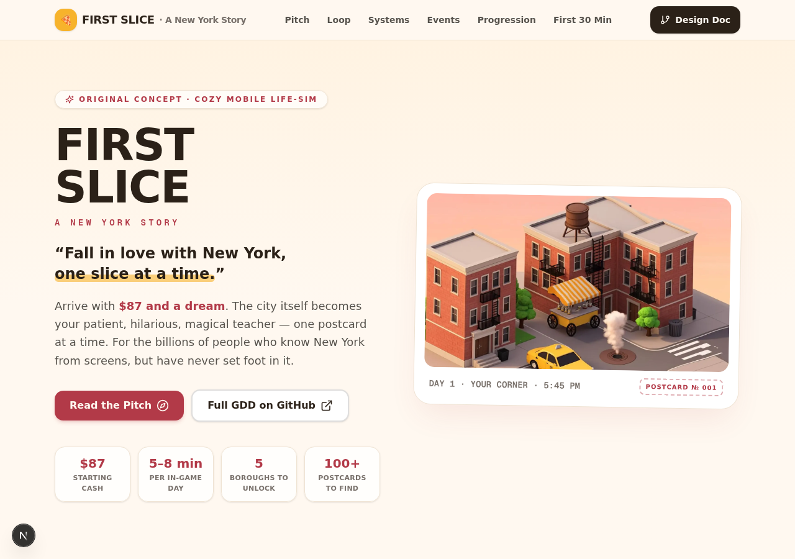
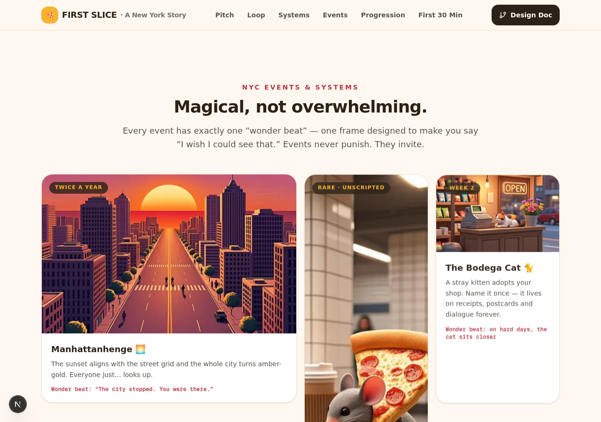
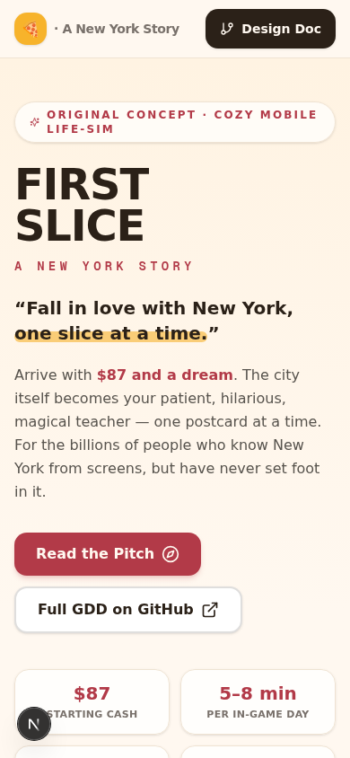

# 🗽 FIRST SLICE
### *A New York Story*

**"Fall in love with New York, one slice at a time."**

*A cozy lowpoly life-simulation game for the billions of people who have never set foot in New York City — but have dreamed about it their whole lives.*

---

## 🍕 What is this?

**FIRST SLICE** is an original mobile simulation game where you arrive in a stylized, postcard-beautiful New York City as a complete outsider — with **$87 in your pocket**, a duffel bag, and a dream. The city itself becomes your patient, hilarious, magical teacher.

You start with a humble coffee cart on a quiet corner. Through short, satisfying daily sessions you learn the city's ways — how to make a proper bacon-egg-and-cheese, how to say *"on line"* instead of *"in line,"* how to read the subway without fear — and slowly build your own piece of the Big Apple:

**Coffee Cart → Corner Bodega → Neighborhood Café → Beloved Food Spot → Rooftop Hangout**

Every session ends with a **postcard** — a beautiful, auto-composed, captioned snapshot of something you discovered — and your album slowly fills with a New York that is uniquely *yours*. By the end, you've never been to Manhattan, but you swear you could navigate it.

> *"I cried at Rosa's bodega anniversary party. I have never even been to New York."*
> — the exact player reaction this game is designed to produce

---

## 🎯 The Design Promise

| Pillar | Commitment |
|---|---|
| **For never-visitors** | Every system assumes zero NYC knowledge. The city is the tutorial — never a popup. |
| **Wonder first** | Every session contains a guaranteed "wonder beat" — a moment designed to make you say *I wish I could see that.* |
| **Postcard beauty** | Lowpoly, golden-hour, bold silhouettes. Every frame readable in a 9:16 screenshot at 1-second scroll speed. |
| **Short & satisfying** | One in-game day = 5–8 minutes. The perfect commute game, with a natural stopping point every session. |
| **Meme-native** | Pizza Rat moments, Bodega Cats, Manhattanhenge. Systems designed to be screenshotted and shared. |

---

## 🖼️ Pitch Site Preview

An interactive one-page pitch deck presenting this concept was built alongside these docs (screenshots below):

| | |
|---|---|
|  |  |
| *Hero: postcard-framed key art* | *Events: the wonder-beat gallery* |

*Mobile-first — the game is designed vertical-first too (the TikTok law).*

---

## 🆕 What's new in v2.0

Four systems adopted from our companion concept **Saved You a Seat** are now canon:

- **Map** — the co-newbie paper companion who learns alongside you *(GDD §4.0)*
- **The Three-Layer Landmark** — Postcard → Tuesday → Kindness *(GDD §4.2)*
- **The Skyline of Lit Windows** — progress you can film, never a menu *(GDD §6.4)*
- **The Inverted Loop** — *Someone's First New York* + the Welcome Bench: the endgame of hospitality *(GDD §6.5)*

And two new working documents: the full **Production Roadmap** ([06](docs/06-production-roadmap.md)) and the **Vertical Slice Design** ([07](docs/07-vertical-slice-design.md)) — plus **[AGENTS.md](AGENTS.md)**, an operations manual with a skills library for AI agents contributing to the project.

---

## 📚 Documentation

| Document | Contents |
|---|---|
| **[01 — Game Design Document](docs/01-game-design-document.md)** | The complete concept: title, pitch, core loop, teaching systems, events, progression, art direction, first-session script, and the full viral case. *(The source of truth.)* |
| **[02 — First Session Walkthrough](docs/02-first-session-walkthrough.md)** | A minute-by-minute script of the first 30 minutes, with dialogue samples and wonder-beat placement. |
| **[03 — NYC Events & Systems Compendium](docs/03-events-compendium.md)** | 25+ original NYC-flavored events and systems — from Pizza Rat to Manhattanhenge — each with the "wonder beat" identified. |
| **[04 — Art Direction Bible](docs/04-art-direction-bible.md)** | The Postcard Warm palette, camera language, lighting rules, UI motifs, and the "1-second screenshot" readability law. |
| **[05 — Viral & Growth Playbook](docs/05-viral-growth-playbook.md)** | UGC engine design, share-card system, TikTok-native moments, K-factor mechanics, and market analysis. |
| **[06 — Production Roadmap](docs/06-production-roadmap.md)** | Phases 0–6 with epic/task breakdown, team shape, engine decision, KPI gates, risk register, and definitions of done. |
| **[07 — Vertical Slice Design](docs/07-vertical-slice-design.md)** | The first 30 minutes at shippable quality: scope in/out, feature specs VS-F01→F10, content inventory, perf budgets, exit criteria. *(v0.1 — work in progress.)* |
| **[AGENTS.md](AGENTS.md)** | Operations manual for AI agents: the seven design Laws, voice guide, workflow protocol, and a 9-skill library (system-spec, content-pipeline, slice-guardian, implement-epic, visual-qa, playtest-analysis, art-brief…). |

---

## 🌆 The Fantasy

> **"Experience the dream of New York without ever leaving your phone."**

New York is the world's most *imagined* city. Billions of people carry a parasocial relationship with it — from movies, from TikTok, from hip-hop, from sitcoms. They know the yellow cabs, the steam curling from manholes, the pizza slices bigger than their face. They've never been. They've always wanted to.

**FIRST SLICE is the plane ticket that doesn't cost flight money.**

It celebrates the *myth* of New York — opportunity, energy, diversity, late-night food, street life — while treating it with enough authenticity to make real New Yorkers smile and say *"that's so us."*

---

## 🕹️ Core Loop in 10 Seconds

1. ☕ **Morning — Open Up.** Serve a rush of customers; every order is a little culture lesson.
2. 🚶 **Midday — Go Explore.** Walk a living block. Meet people. Trigger discoveries. Take postcards.
3. 🛠️ **Evening — Build Your Slice.** Upgrade your spot. Advance a regular's story.
4. 🌙 **Night — City Wind-Down.** A slow, atmospheric moment + one random "New York Moment."
5. 📮 **End — The Postcard.** Your session gets auto-composed into a shareable memory. Day complete.

---

## 👥 Who It's For

- **The Armchair New Yorkers** — billions worldwide who know NYC only through screens
- **Cozy game fans** — Animal Crossing, Townscaper, A Little to the Left players
- **Life-sim lovers** — Stardew, Dave the Diver, Coffee Talk audiences
- **The NYC diaspora** — former New Yorkers who miss it
- **Future visitors** — the game becomes their trip-planning dream board

---

## 📄 License & Status

Concept documentation © 2025 First Slice Team. All names, systems, and content are original to this document. Game concept available for development partnership discussions.

**Start small. Dream big. The city will teach you.** 🗽

