<div align="center">

# 🗽 FIRST SLICE
### *A New York Story*

**"Fall in love with New York, one slice at a time."**

*A cozy lowpoly life-simulation game for the billions of people who have never set foot in New York City — but have dreamed about it their whole lives.*

[Game Design Document](docs/01-game-design-document.md) · [Vertical Slice](docs/07-vertical-slice-design.md) · [Greybox](greybox-godot/) · [AGENTS.md](AGENTS.md)

</div>

---

## What is this?

**FIRST SLICE** is an original mobile simulation game where you arrive in a stylized, postcard-beautiful New York as a complete outsider — with **$87**, a duffel bag, and a dream. The city itself becomes your patient, funny, magical teacher.

You start with a humble coffee cart on a quiet corner. Through short daily sessions you learn the city’s ways and slowly build your own piece of it:

**Coffee Cart → Bodega → Café → Food Spot → Rooftop**

Every session ends with a **postcard** — a beautiful, auto-composed, captioned snapshot of something you discovered. By the end you’ve never been to Manhattan, but you swear you could navigate it.

> *“I cried at Rosa’s bodega anniversary party. I have never even been to New York.”*  
> — the exact player reaction this game is designed to produce

---

## Design Promise

| Pillar | Commitment |
|--------|------------|
| **For never-visitors** | Zero NYC knowledge assumed. The city is the tutorial. |
| **Wonder first** | Every session has a designed “I wish I could see that” moment. |
| **Postcard beauty** | Lowpoly, golden-hour, vertical-first. Readable in one second. |
| **Short & satisfying** | One in-game day ≈ 5–8 minutes. Natural stopping point every session. |
| **Share-native** | Postcards and skyline moments are built to be sent to friends. |

---

## Current Status — Two Days Are Alive, in Two Engines

The Day 1 greybox **and Day 2** are playable in **Godot 4.7** — and now also in **the browser** ([`web-three/`](web-three/), the Three.js migration, [Doc 24](docs/24-web-three-build.md)).

<div align="center">

**▶ [Play in the browser](https://desurfofficial-ship-it.github.io/first-slice-nyc/) ◀**

*WASD walk · Space interact · Z/C turn camera · touch controls on mobile*

</div>

```bash
# play the browser build locally
cd web-three && npm install && npm run dev     # http://localhost:5173

# or the Godot greybox
godot --headless --path greybox-godot -- --autotest
```

**Day 1 path:**  
Terminal → Rosa's bodega → first rush → name your cart → serve Mr. Idris → climb the fire escape at dusk → watch one window turn gold → receive your first postcard.

**Then Day 2 — [the neighborhood comes alive](docs/22-day2-greybox.md):**  
The postcard closes, you can linger at the rail, and tomorrow begins: Idris comes back for the usual, Rosa asks you to keep the kid in the gold window, the awning goes up ($15, real tips, the lunch rush follows), and at dusk a second window lights. Your corner persists — quit any time, resume exact.

```bash
godot --headless --path greybox-godot -- --autotest
```

Last headless run: **0 failures, 46 checks — full Day 1 + Day 2 + the three Doc 21 seams closed + the day-start money arc**.

### Real captures from the greybox

| Spawn | Bodega | Named Cart | Gold Window |
|-------|--------|------------|-------------|
| 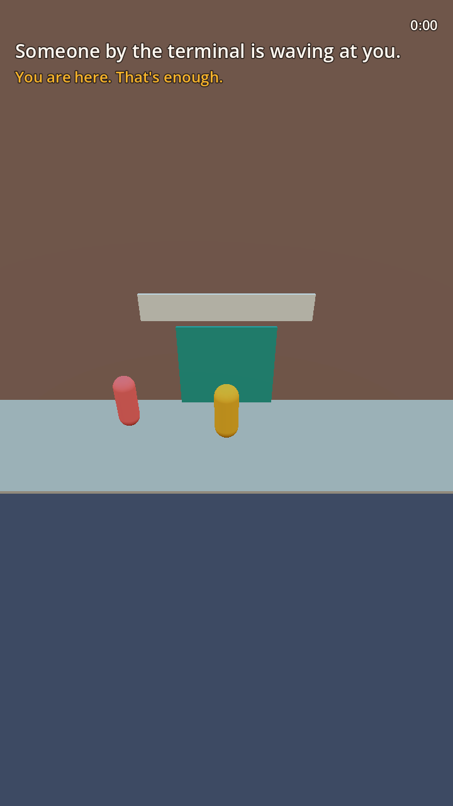 | 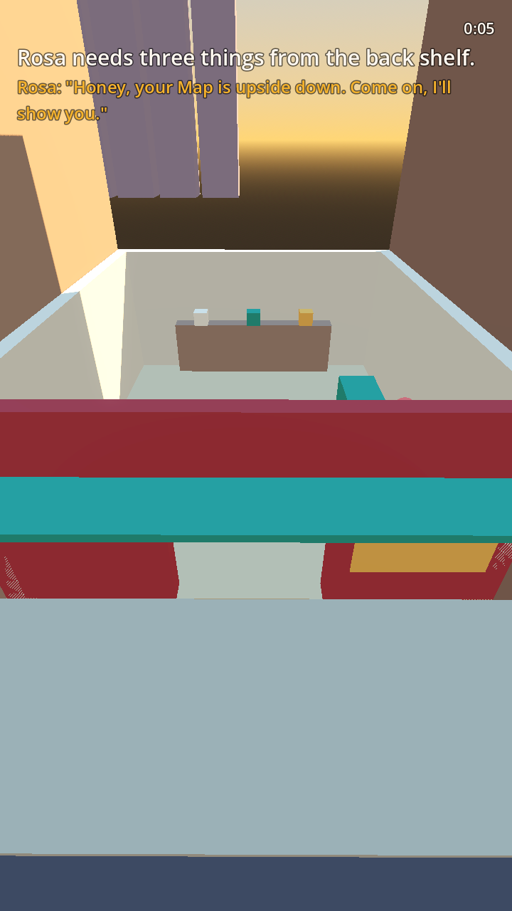 | 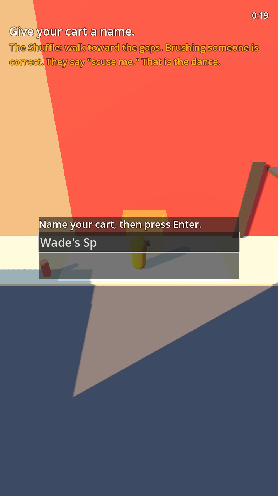 | 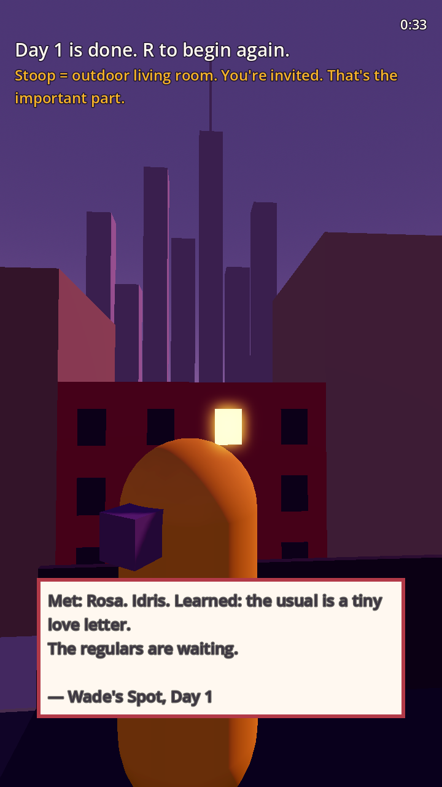 |

### Day 2, seen — [Doc 24](docs/25-day2-render-notes.md)

| Title Card | Teal Door | Awning Up | Two Windows |
|------------|-----------|-----------|-------------|
| 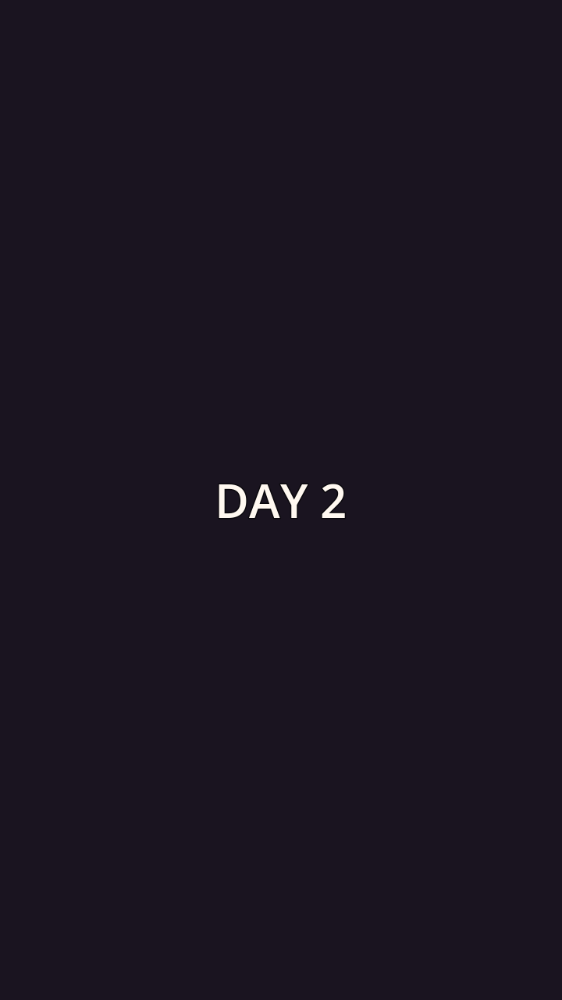 | 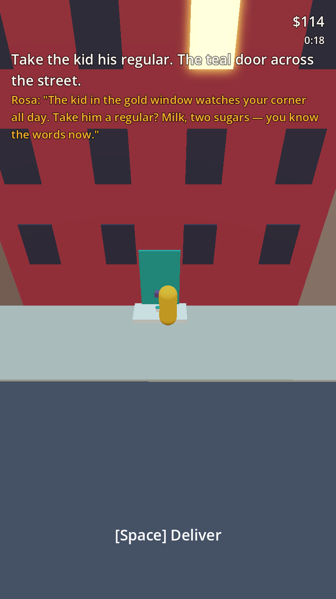 | 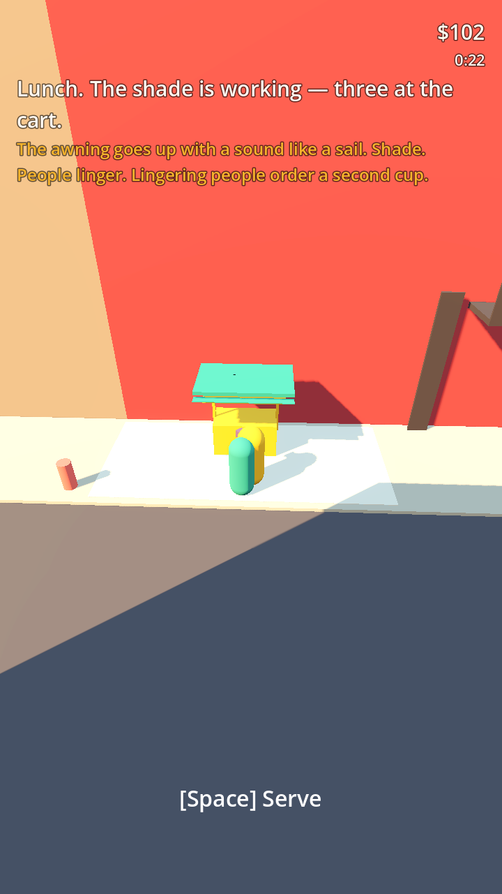 | 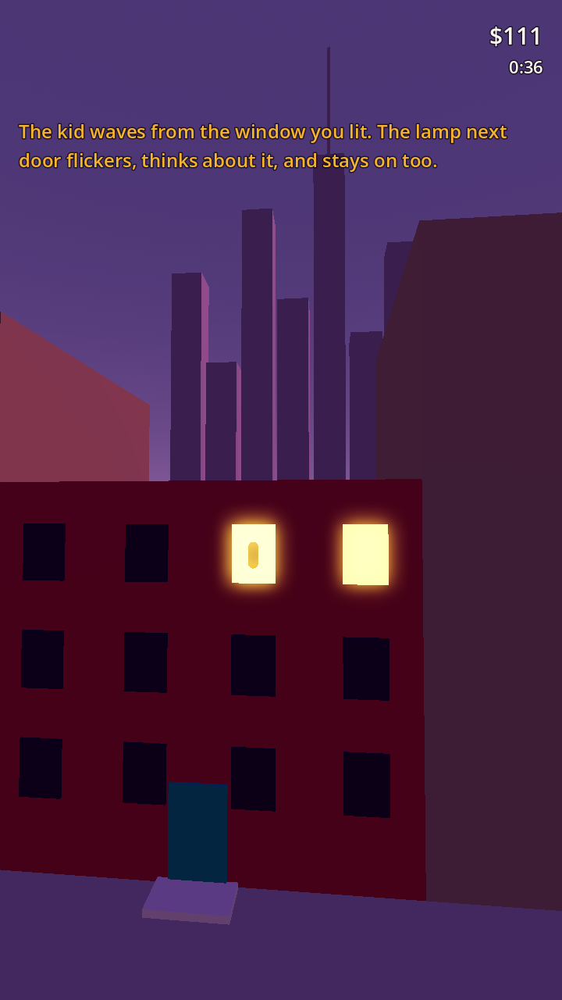 |

### First generated postcard

<div align="center">

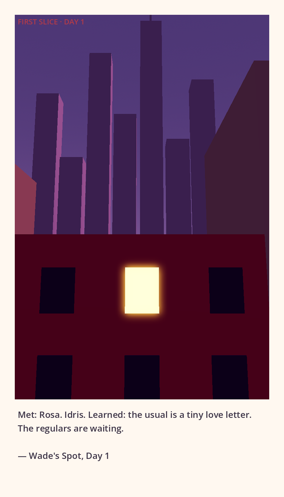

*TS-01 proven: real scene → composed postcard → PNG*

</div>

---

## Locked Styleframes

These are the official visual targets for production.

| A — Golden-Hour Corner | B — Dusk Fire Escape | C — First Postcard Framing |
|------------------------|----------------------|----------------------------|
| 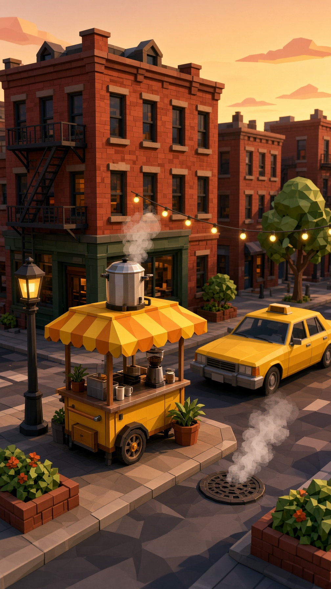 | 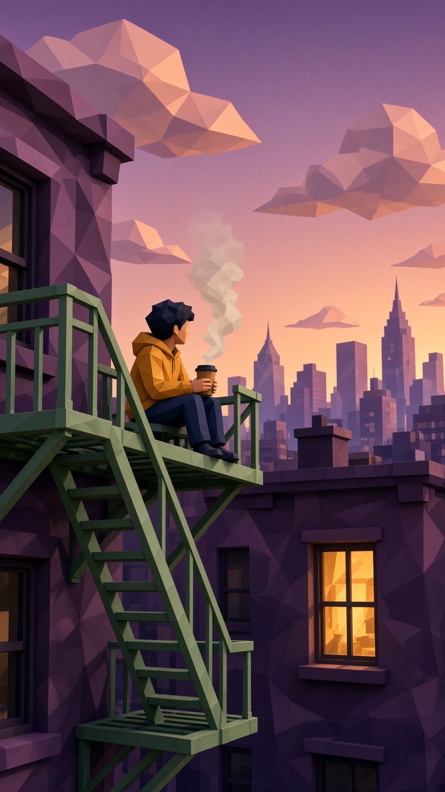 | 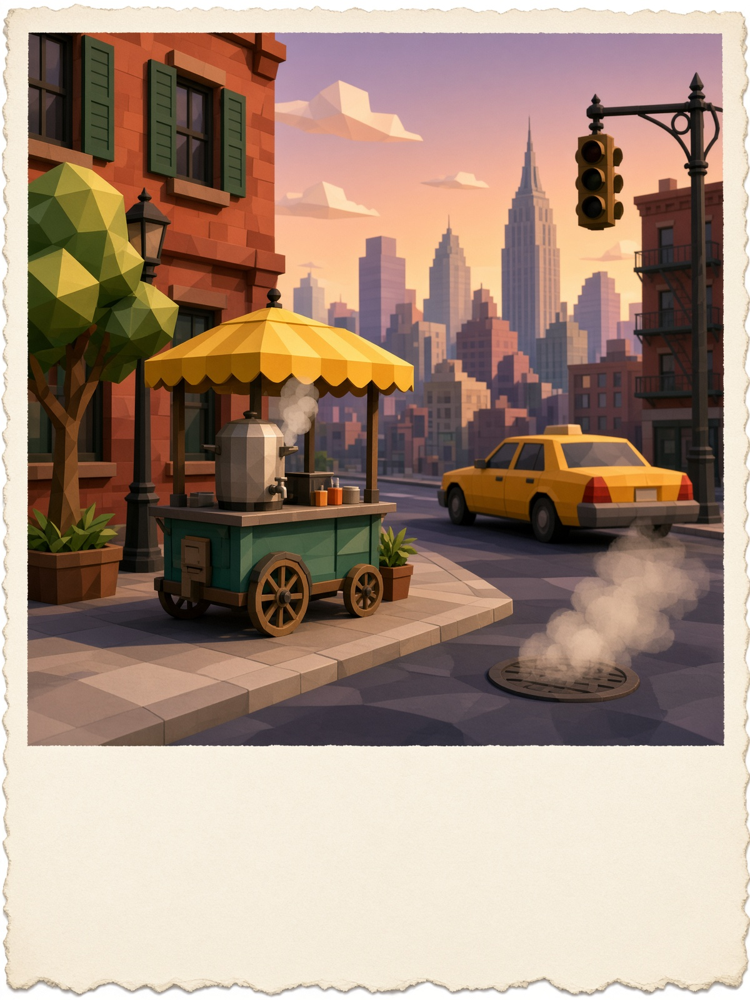 |

Full lock notes: [Doc 14](docs/14-styleframe-lock.md)

---

## Proven Tech Spikes

| Spike | Result |
|-------|--------|
| **TS-01 · Postcard Capture** | Full pipeline working. Day → glide → offscreen render → paper frame + caption → shareable PNG. |
| **TS-02 · Vertical Camera** | One camera, three poses, smooth blends. Safe margins confirmed in portrait. |
| **Synthetic Playtest (n=5)** | Five scripted walkers found three real seams: one-door crosswalk, one-way ladder, frozen ending. **All three now fixed and re-verified** — corner_cutter: stuck → completed. Logs committed. [Doc 21](docs/21-synthetic-playtest-01.md). |
| **Day 2 · The Neighborhood Comes Alive** | Day progression, save v1 (resume exact, no duplicate rewards), returning Rosa/Idris, the kid's regular, the awning, the second window. [Doc 22](docs/22-day2-greybox.md). |

Details and numbers live in [Doc 15](docs/15-tech-spikes.md).

---

## Core Loop (10 seconds)

1. **Morning — Open Up** → Serve the rush. Every order teaches a little culture.
2. **Midday — Go Explore** → Walk the block. Discover. Take postcards.
3. **Evening — Build Your Slice** → Upgrade your spot. Advance a regular’s story.
4. **Night — City Wind-Down** → Slow moment + one New York Moment.
5. **The Postcard** → Your day becomes a shareable memory. Session complete.

---

## Documentation

| Doc | What it is |
|-----|------------|
| [01 – Game Design Document](docs/01-game-design-document.md) | Full vision & systems (source of truth) |
| [02 – First Session Walkthrough](docs/02-first-session-walkthrough.md) | Minute-by-minute Day 1 script |
| [07 – Vertical Slice Design](docs/07-vertical-slice-design.md) | What must ship in the first 30 minutes |
| [08 – Day 1 Content Pack](docs/08-day1-content-pack.md) | Final Map notes + postcards |
| [10 – Greybox Layout](docs/10-day1-greybox-layout.md) | Spatial design of the block |
| [14 – Styleframe Lock](docs/14-styleframe-lock.md) | Official visual targets |
| [15 – Tech Spikes](docs/15-tech-spikes.md) | Camera + Postcard results |
| [16 – Risk Register](docs/16-risk-register.md) | What can still break the feeling |
| [17 – Greybox Tasks](docs/17-greybox-tasks.md) | Concrete build checklist |
| [19 – First-Build Guide](docs/19-greybox-first-build.md) | How to open the project and start |
| [20 – Day 1 Render Notes](docs/20-day1-greybox-render-notes.md) | First played pass — six camera findings, with evidence frames |
| [21 – Synthetic Playtest 01](docs/21-synthetic-playtest-01.md) | Five scripted walkers, one day — three real seams, now closed |
| [22 – Day 2 Greybox](docs/22-day2-greybox.md) | The neighborhood comes alive — seams fixed, save v1, the second window |
| [24 – Three.js Build](docs/24-web-three-build.md) | The browser migration — stack, evidence, deployment, honest limits |
| [25 – Day 2 Render Notes](docs/25-day2-render-notes.md) | Day 2, finally seen — frames, findings, fixes, and the second postcard |
| [AGENTS.md](AGENTS.md) | Operating manual for AI agents |

---

## Who it’s for

- People who have never been to New York but have always felt it
- Cozy game fans (Animal Crossing, Townscaper, Coffee Talk, Dave the Diver)
- Anyone who wants a short, warm, shareable daily ritual

---

## Project Structure

```
first-slice-nyc/
├── docs/                 # Full design documentation
├── assets/
│   ├── styleframes/      # Locked visual targets
│   └── greybox-day1/     # Real captures + first postcard
├── greybox-godot/        # Playable Day 1 greybox (Godot 4.7)
├── web-three/            # The browser game (Three.js) — live on Pages
├── tools3d/              # Local .glb generation pipeline (TRELLIS + parametric)
└── AGENTS.md             # Agent operating rules & skills
```

---

<div align="center">

**Start small. Dream big. The city will teach you.** 🗽

</div>
