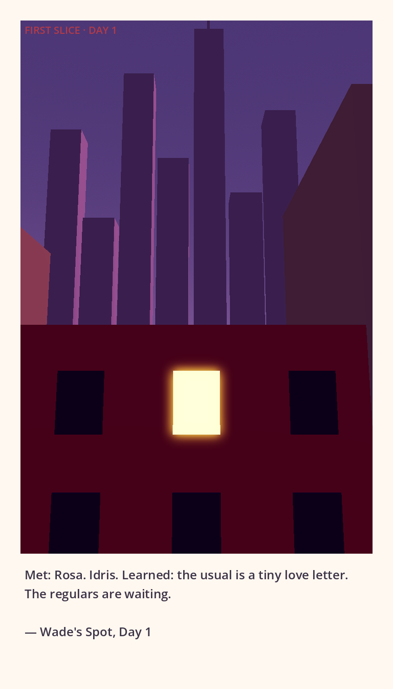
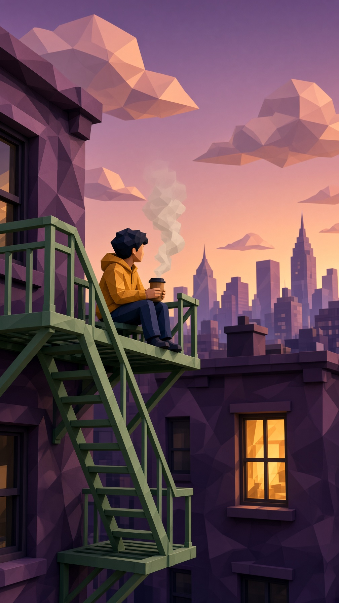
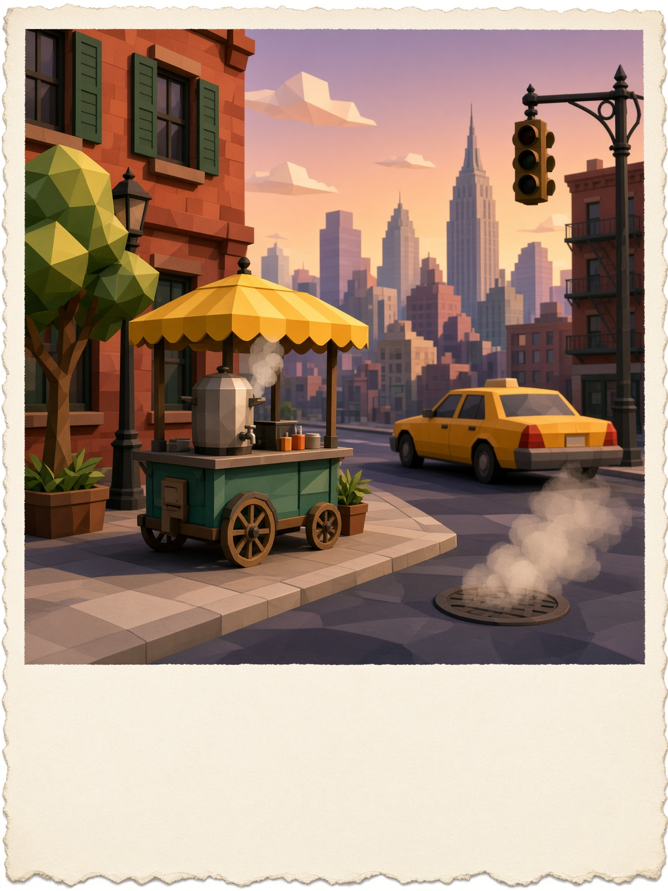

<div align="center">

# 🗽 FIRST SLICE
### *A New York Story*

**"Fall in love with New York, one slice at a time."**

*A cozy lowpoly **open-world New York life simulation**, delivered chapter by chapter, for the billions of people who have never set foot in New York City — but have dreamed about it their whole lives. Today you arrive on one deeply simulated block, Alder Heights — the game's first district: follow the story beat by beat, or tap **Roam** and let the city run on your clock. The city grows by chapters.*

[Narrative Bible](docs/narrative/00-README.md) · [World Contract](docs/architecture/world-contract/) · [Production System](docs/production/README.md) · [AGENTS.md](AGENTS.md)

</div>

---

## What is this?

**FIRST SLICE** is an original mobile simulation game where you arrive in a stylized, postcard-beautiful New York as a complete outsider — with **$87**, a duffel bag, and a dream. The city itself becomes your patient, funny, magical teacher.

You start with a humble coffee cart on a quiet corner. Through short daily sessions you learn the city’s ways and slowly build your own piece of it:

**Coffee Cart → Bodega → Café → Food Spot → Rooftop**

And when the day's errands can wait, **the whole block is yours** — the pocket's **Roam** chip opens every corner from the first minute (the story simply waits where you left it), and the Map circles the story's next spot in Rosa's ink, captioned *whenever you're ready*: ride the subway, shoot half-court, sit on a bench with a slice, read the newsboxes, buy the bodega's mango. The walkers, the traffic, the busker and the street keep living whether you follow Rosa or not — and the morning after a run of regular rounds, the block says so, once.

Every session ends with a **postcard** — a beautiful, auto-composed, captioned snapshot of something you discovered. By the end you’ve never been to Manhattan, but you swear you could navigate it.

> *“I cried at Rosa’s bodega anniversary party. I have never even been to New York.”*  
> — the exact player reaction this game is designed to produce

---

## Design Promise

| Pillar | Commitment |
|--------|------------|
| **For never-visitors** | Zero NYC knowledge assumed. The city is the tutorial. |
| **Wonder first** | Every session has a designed “I wish I could see that” moment. |
| **Postcard beauty** | Lowpoly, golden-hour, vertical-first. Readable in one second. |
| **Short & satisfying** | One in-game day ≈ 5–8 minutes. Natural stopping point every session. |
| **Free roam, no leash** | The story is the spine; the city runs on your clock. One Roam chip — no errand is ever forced, no corner is ever locked. |
| **Share-native** | Postcards and skyline moments are built to be sent to friends. |

---

## Current Status — Four Days Are Alive in the Browser

Day 1, Day 2, **Day 3, and Day 4 (morning + afternoon)** are playable in **the browser** ([`web-three/`](web-three/), Vite + TypeScript + Three.js, [Doc 24](docs/24-web-three-build.md)): the block has brownstones, storefronts, a subway plaza, street trees, pigeons, a squirrel, Sunrise Laundry, a filed permit on the cart — and four full days.

<div align="center">

**▶ [Play in the browser](https://desurfofficial-ship-it.github.io/first-slice-nyc/) ◀**

*WASD walk · Space/E interact (E is interact-only — it never turns the camera) · Z/C or Q turn camera · M opens the Map · touch controls on mobile · ♫ sound on/off*

</div>

```bash
# play the browser build locally
cd web-three && npm install && npm run dev     # http://localhost:5173
```

**Day 1 path:**  
Terminal → Rosa's bodega → first rush → name your cart → serve Mr. Idris → climb the fire escape at dusk → watch one window turn gold → receive your first postcard.

**Then Day 2 — [the neighborhood comes alive](docs/22-day2-greybox.md):**  
The postcard closes, you can linger at the rail, and tomorrow begins: Idris comes back for the usual, Rosa asks you to keep the kid in the gold window, the awning goes up ($15, real tips, the lunch rush follows), and at dusk a second window lights. Your corner persists — quit any time, resume exact.

**Then Day 3 — [a place at the corner](docs/28-day3-a-place-at-the-corner.md) (web build):**  
Rosa brings the news at YOUR cart. The morning rush is four real orders — bubbles up, urn hissing, money honest. Then the kid comes down from the window for the first time, walks to your corner at your hip, and takes the stool ($10). A flyer by the subway stairs says the block knows your name. At dusk a third window lights, and the kid waves from his stool below.

**Then Day 4 — [say hi](docs/29-day4-say-hi.md) (web build):**  
The Hospitality Law chapter. A stranger with a duffel bag stands where the story started. Rosa: "You looked like that once. Go say hi." One free regular, Rosa's two dollars, three honest orders — and the Map changes hands. She walks your first walk; the corner does not own her. **And Day 4 afternoon — [the block opens up](docs/30-day4-the-block-opens-up.md):**  
The block was always this big. Sunrise Laundry is a real place now — Sal, two washers, one mango-stained apron (first wash free: "the aprons are advertising") — and by the crosswalk, a city notice: MOBILE FOOD VENDING PERMIT — APPLICATION. $10 to file, confirm-gated, spent once. The receipt goes on the cart. At dusk the lamp next door flickers, thinks about it, and stays on. Four windows, one filed application, and Day 5 is still being written — the light stays.

**And the block keeps a diary — [Doc 34](docs/34-living-block-implemented.md), the living block:**  
The flyer board rotates its paper (a lost cat, a stoop sale, a street fair). Windows wake and sleep — someone got home late, someone new moved in, the early riser beats you to the morning. The water-main barrier is gone by Day 4, leaving fresh asphalt. Idris remembers the kid. Rosa has a line she only says when the Map changes hands. And one neighbor — stone-gray cardigan, folded paper under her arm — passes your cart on Day 2, nods on Day 3, and on Day 4, during the wash, spends one word: "Morning." On this block, that's a handshake.

```bash
cd web-three && npm test && node scripts/e2e.mjs   # the build: Day 1 + 2 + 3 + 4
```

Last runs: **web E2E AUTOTEST OK, 0 failures (535 s — full Day 1 → Day 4 afternoon, real input)** · **582/582 unit tests** · typecheck clean.

### Day 3, seen — [Doc 28](docs/28-day3-a-place-at-the-corner.md)

| The Subway Plaza | Brownstone Row | The Kid's Stool | Three Windows |
|------------------|----------------|-----------------|---------------|
|  |  |  |  |

### Day 4, seen — [Doc 29](docs/29-day4-say-hi.md) + [Doc 30](docs/30-day4-the-block-opens-up.md)

| The Stranger, At the Terminal | She Walks Your First Walk | The Block Opens Up | Four Windows |
|-------------------------------|---------------------------|--------------------|--------------|
|  |  |  |  |

### The living block, seen — [Doc 34](docs/34-living-block-implemented.md)

| The Board's Diary (D1 / D4) | The Barrier's Last Day | Windows Awake (D4) | The Familiar Face |
|------------------------------|------------------------|--------------------|-------------------|
|  |  |  |  |

### First generated postcard

<div align="center">



*TS-01 proven: real scene → composed postcard → PNG*

</div>

---

## Locked Styleframes

These are the official visual targets for production.

| A — Golden-Hour Corner | B — Dusk Fire Escape | C — First Postcard Framing |
|------------------------|----------------------|----------------------------|
|  |  |  |

Full lock notes: [Doc 14](docs/14-styleframe-lock.md)

---

## Proven Tech Spikes

| Spike | Result |
|-------|--------|
| **TS-01 · Postcard Capture** | Full pipeline working. Day → glide → offscreen render → paper frame + caption → shareable PNG. |
| **TS-02 · Vertical Camera** | One camera, three poses, smooth blends. Safe margins confirmed in portrait. |
| **Synthetic Playtest (n=5)** | Five scripted walkers found three real seams: one-door crosswalk, one-way ladder, frozen ending. **All three now fixed and re-verified** — corner_cutter: stuck → completed. Logs committed. [Doc 21](docs/21-synthetic-playtest-01.md). |
| **Day 2 · The Neighborhood Comes Alive** | Day progression, save v1 (resume exact, no duplicate rewards), returning Rosa/Idris, the kid's regular, the awning, the second window. [Doc 22](docs/22-day2-greybox.md). |

Details and numbers live in [Doc 15](docs/15-tech-spikes.md).

---

## Core Loop (10 seconds)

1. **Morning — Open Up** → Serve the rush. Every order teaches a little culture.
2. **Midday — Go Explore** → Walk the block. Discover. Take postcards.
3. **Evening — Build Your Slice** → Upgrade your spot. Advance a regular’s story.
4. **Night — City Wind-Down** → Slow moment + one New York Moment.
5. **The Postcard** → Your day becomes a shareable memory. Session complete.

---

## Documentation

The legacy numbered design docs were cleared in the narrative reboot
(git `a6e0541`) — the canon lives here now:

| Doc | What it is |
|-----|------------|
| [Narrative Bible](docs/narrative/00-README.md) | The story canon (00–15): vision, characters, the spine, the implementation spec |
| [World Contract](docs/architecture/world-contract/) | The 17 contract documents — the world sim's laws |
| [Production System](docs/production/README.md) | Roadmap, status register, governance, acceptance checklists, risks |
| [57 – Engineering References](docs/57-engineering-references.md) | Study-before-build verdicts and reference-repo notes |
| [AGENTS.md](AGENTS.md) | Operating manual for AI agents |

---

## Who it’s for

- People who have never been to New York but have always felt it
- Cozy game fans (Animal Crossing, Townscaper, Coffee Talk, Dave the Diver)
- Anyone who wants a short, warm, shareable daily ritual

---

## Project Structure

```
first-slice-nyc/
├── docs/                 # Full design documentation
├── assets/
│   ├── styleframes/      # Locked visual targets
│   ├── postcards/        # The first composed postcards (Day 1, Day 2)
│   └── web-three/        # In-game evidence frames
├── web-three/            # THE GAME (Three.js + Vite) — live on Pages
├── tools3d/              # .glb generation pipeline (TRELLIS + parametric)
└── AGENTS.md             # Agent operating rules & skills
```

---

<div align="center">

**Start small. Dream big. The city will teach you.** 🗽

</div>
