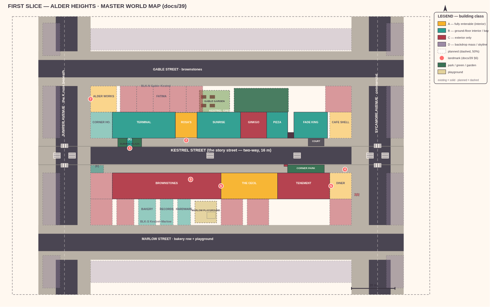
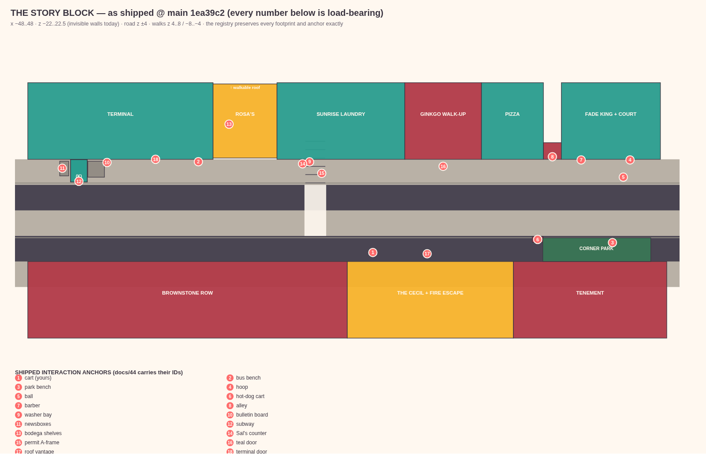
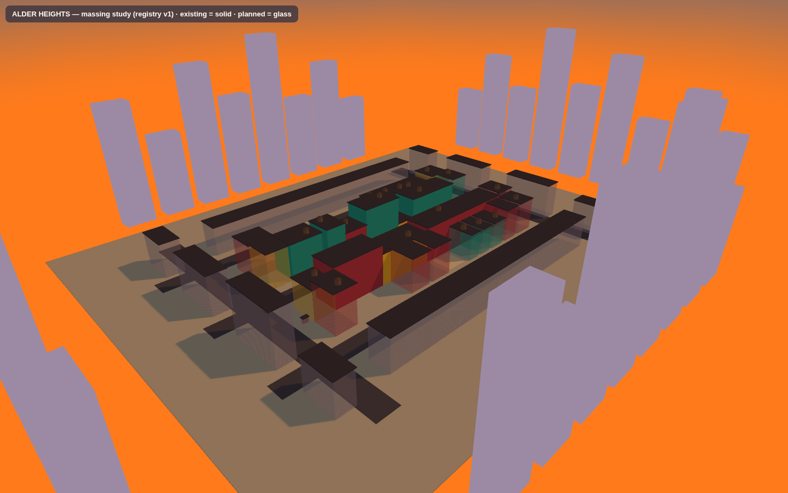
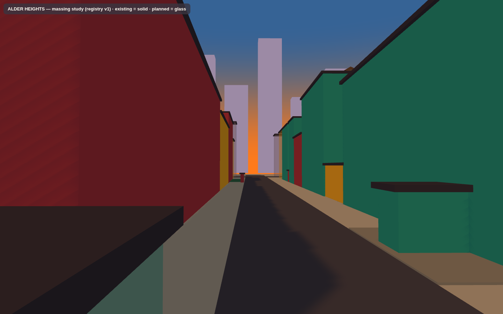
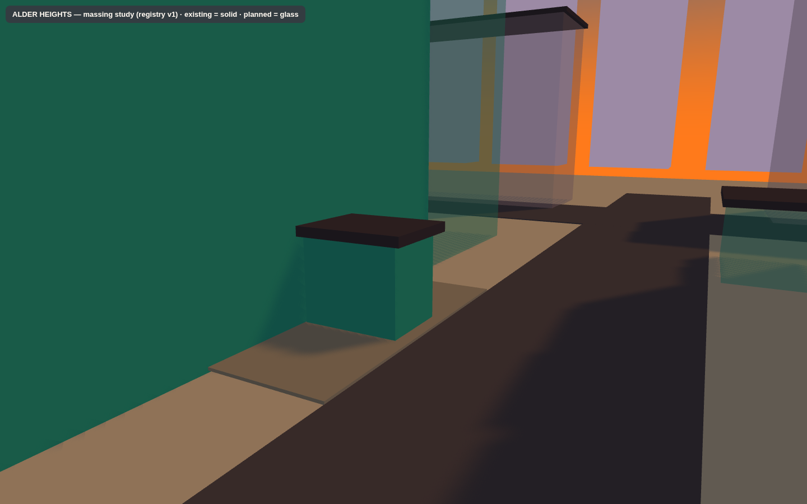

# Doc 39 — Master World Map: Alder Heights, the complete playable neighbourhood

> **Master World Design milestone — deliverable A.** This milestone is DESIGN FIRST:
> nothing in `web-three/src/` was touched, and construction waits for approval
> (docs/45 is the phase plan that consumes this map).
> Machine source of truth: [`docs/data/world-registry.json`](data/world-registry.json) —
> validated by `scripts/design/validate-registry.mjs` (green: 116 IDs, shipped-world
> fidelity 12/12 masses, 18/18 interaction anchors).

---

## 1. What this map is

The complete intended playable neighbourhood of FIRST SLICE, designed as **one
coherent place before another wall is built**. It answers the twenty questions the
milestone brief asks (where the player lives, where the streets run, where people
gather, how it all connects) with **coordinates, not vibes** — every rectangle on
this map exists in the registry with an ID, a footprint, a class, and a reason.

**The neighbourhood: ALDER HEIGHTS** — a fictional pocket of upper Manhattan
between Harlem and Washington Heights. Two avenues, three streets, two blocks,
one subway line, one bus, three parks, one diner, one community hall, one brownstone
row, and the block the story already lives on, untouched at its heart.

**Naming canon (the milestone's one act of naming authority):** the shipped story
(docs 08/30/33/34, `content.ts`) never names the neighbourhood or any street. These
names are new canon issued by this milestone and flagged as reversible until phase
W1 ships signage:

| Entity | Name | Rationale |
|---|---|---|
| Neighbourhood | **Alder Heights** | Dutch-colonial street-name grammar; "heights" matches the existing skyline-card masses and the GDD's upper-Manhattan Regulars (Rosa's Washington Heights bodega canon stays coherent one subway stop away) |
| Story street (E-W) | **Kestrel Street** | A bird street name (real NYC grammar: Falcon Ave, Sparrow St); warm, sayable, and the cart corner becomes "Kestrel & the park" in dialogue |
| West avenue (N-S) | **Juniper Avenue** | The local avenue; the K subway runs beneath it |
| East avenue (N-S) | **Sycamore Avenue** | The busier commercial avenue; big street-tree species for a big street |
| North street (E-W) | **Gable Street** | The brownstone street |
| South street (E-W) | **Marlow Street** | Bakery row + the playground |
| Subway line / station | **the K — "Alder Heights"** | K is unused in service (retired 1967 BMT K); bullet colour = Taxi Yellow `#F7B32B` per Doc 04 |
| Bus | **M121** | Manhattan M-series numbering; M121 is unassigned in the real system |

## 2. Boundaries and the coordinate law

| Layer | Extent | Notes |
|---|---|---|
| **World bounds** | x ∈ [−96, 96], z ∈ [−64, 64] | 192 × 120 m. The single authoritative box; nothing playable exists outside it. |
| **Playable core** | x ∈ [−84, 84], z ∈ [−48, 48] | Streets + two blocks; everything in here is authored content. |
| **Shipped walls today** | x ±48, z −22/22.5 | The temporary invisible walls in `World.ts:496`. Retired **phase by phase** (docs/45) — never before a district has content behind it. |
| **Skyline cards** | N (z = 90, existing), S (z = −106), E/W (x = ±142 in the study; card planes at ±110 registry-authoritative) | The existing trick closes every sight line beyond the core. |

**The origin does not move.** The existing world IS the middle of this map: the
story block spans x −50..50, z −22..22.5 today, and the master grid simply
continues its materials, levels, and laws outward. Units are meters; +x = east,
+z = north; footprints are `{x, z, w, d}` = center + full size, exactly
`boxFromCenter()` convention.

## 3. The grid (compressed from the real 1811 plan, ratios preserved)

Reference: the Commissioners' Plan of 1811 — avenues 100 ft (30 m), cross streets
60 ft (18 m), blocks 200 ft (61 m) N-S × 620–920 ft (189–280 m) E-W, standard lot
25 × 100 ft (7.6 × 30 m) (MCNY, *The Greatest Grid*). Alder Heights compresses
~25% for game density **but keeps every ratio that makes a street read as New York**:

| Street | Axis | Total width | Road | Sidewalks | Real-plan analogue |
|---|---|---|---|---|---|
| Kestrel Street | E-W | **16 m** | 8 | 4 + 4 | cross street (60 ft) |
| Juniper Avenue | N-S | **24 m** | 10 | 8 + 8 | avenue (100 ft) — wait, compressed |
| Sycamore Avenue | N-S | **24 m** | 10 | 8 + 8 | avenue |
| Gable / Marlow | E-W | 16 m | 8 | 4 + 4 | residential cross streets |

Avenues are visibly wider than Kestrel in plan and in the camera; blocks are
120 × 24 m of building belt (short blocks — upper Manhattan grammar, and the
reason every face gets storefronts without a single dead 100 m wall).

**Kestrel is two-way** (one 4 m lane each way). Evidence from the shipped world:
the cab drives eastbound in the south lane (z = −2, right-hand traffic), the
GOLDEN ORCHARD van parks nose-west on the north curb against the westbound lane,
and the Yuka walker comment says "two lanes per direction". The existing ONE WAY
sign is retained as the terminal-exit sign.

## 4. The districts (where everything is, and why)

### BLK-N — the Gable–Kestrel block (north)
- **South face (Kestrel, N side) — THE STORY STREET, 100% preserved.** Terminal
  (KTN-01), Rosa's (ROS-01), Sunrise Laundry (KTN-02), the Ginkgo Walk-up with the
  gold windows and the teal door (KTN-03), Corner Slice (KTN-04), the alley (ALY-01),
  Fade King + the half-court (KTN-05). Two corner infills complete the face:
  **the Corner House** (KTN-00W, chamfered corner store) and — on the Sycamore
  corner — **6 Kestrel Street East, the café shell** (KTN-06): vacant now, papered
  windows, "FOR RENT" card; this is the Slice-Ladder stage-3 café location, reserved
  by the registry so no future agent builds over it.
- **North face (Gable, S side):** five brownstones (GRB-01..05, 7.6 m lots per the
  real rowhouse grammar; GRB-03 is Fatima's future restoration). Stoop-sale street.
- **West face (Juniper):** **Alder Works Hall** (KCM-01) — community hall, marquee
  landmark, the block party's rain plan.
- **East face (Sycamore):** Sycamore Studios (KTN-07, artist ground floor).
- **Interior:** **Kestrel Green** (PRK-GREEN — lawn, pergola, three benches, the
  reading park) and **the Gable Garden** (GRD-GABLE — four beds, shed, water
  barrel; "where the kitchens never end" made literal), plus one parking strip.

### BLK-S — the Kestrel–Marlow block (south)
- **North face (Kestrel, S side) — THE CART CORNER, 100% preserved.** Brownstone
  row (KTS-01), **the Cecil** (KTS-02 — the fire-escape building; **the player's
  home from Week 2**, top-floor room off the upper landing, roof reserved for the
  stage-5 Rooftop), the East Tenement with the future mural gable (KTS-03),
  Corner Park (PRK-CORNER), the dirty-water dog cart (VND-01), and the parked
  GOLDEN ORCHARD van.
- **South face (Marlow, N side):** **the bakery / B-side Records / hardware row**
  (SMB-01..03 — the Happy-Accident record shop lives one street from the subway,
  exactly where GDD §4.3's lore put it), pre-war walk-ups (PWK-01..03), and
  **Marlow Playground** (PLY-MARLOW — swings, sandbox, the dry spray basin that
  becomes Hydrant Summer) with its gate ON Marlow for eyes-on safety.
- **West face (Juniper):** the **K-line south control house** (SUB-02, on the
  corner sidewalk — real NYC type) in front of **Juniper Tenements** (TEN-01,
  with the light-slot tell) and Juniper Court (SRC-02).
- **East face (Sycamore):** **the Alder Heights Diner** (SND-01, corner anchor,
  coral neon, Big Mike's future tie) + Sycamore Court (SRC-01).

### The avenues' outer faces — Class D street walls
Simplified backdrop masses (VDN-DW1a-d, VDN-DE1a-d, VDN-DN1, VDN-DS1): real
footprints and heights, storefront hint bands, **no interiors, no walkable depth
behind** — the same honesty as the skyline cards, one step closer.

## 5. How a player moves through it (the connective tissue)

- **Kestrel spines** (existing sidewalks, extended ±84) + the existing mid-block
  signalized crossing at x = −5 and the x = 9.4 story crossing — both untouchable.
- **New:** full crosswalk sets at all six intersections + the court crossing
  (x = 35), all with the cab's courtesy-hold zones extended.
- **The alley becomes a real shortcut:** ALY-01 (shipped slot) extends north as a
  service lane into Kestrel Green and out the Gable gate — Kestrel→Gable on foot
  without touching an avenue. **The garden slot** (x −3, between the laundry and
  ginkgo buildings' rears) connects Kestrel to the Gable Garden.
- **Avenues:** Juniper (the K below, terminal, hall, tenements) and Sycamore
  (diner, fruit stand, studios, shops) each get sidewalk spines, trees, and one
  vehicle rail in phase W4 (Juniper southbound x = −74; Sycamore northbound x = +70).
- **Transit:** one station, two entrances (SUB-01 shipped, SUB-02 control house),
  mezzanine slice optional (MEZZ-INT); bus M121 loop with three stops.

## 6. Landmarks — the seven things you navigate by

| # | Landmark | Anchor | Why it exists |
|---|---|---|---|
| 1 | **The K-Globes** | SUB-01 + SUB-02 | Twin green-globe entrances one block apart; "meet me by the globe" |
| 2 | **Rosa's Rooftop Billboard** | ROS-01 | The name over the block (shipped) |
| 3 | **The Three Towers** | water towers | The October silhouette line; W1 adds two more so every district frame carries a tank |
| 4 | **The Diner Sign** | SND-01 | Coral neon on the Sycamore corner; the east navigation anchor |
| 5 | **The Garden Mural** | KTS-03 east gable | Neighbourhood-scale painting; Lena & Odd arc hook |
| 6 | **The Ghost Sign** | KTS-02 west gable | "HOLLIS & DAUGHTERS — FINE TEAS EST. 1911", faded paint the dusk camera finds |
| 7 | **Alder Works Marquee** | KCM-01 | The hall's notice board, the neighbourhood's big bulletin board |

All seven are local-scale — no oversized monuments, per the brief. Each is
readable in the 3/4 chase cam and composes in 9:16.

## 7. Massing proof (the same registry, in the game's own three.js)

`scripts/design/massing.html` + `massing-view.mjs` (non-destructive planning
tools) extrude the registry with **the project's own three.js 0.186** — existing
masses solid, planned masses glass. The overview shows the whole diorama holds:
two blocks, six intersections, street walls everywhere, no orphan edges, the
sunset glow ending both avenues (Manhattanhenge law). The eye-level view shows
Kestrel already reads as a street canyon at the real camera height.

## 8. What was retained / redesigned / relocated / removed

| Verdict | Items |
|---|---|
| **Retained, untouched** | All 12 shipped masses and 18 interaction anchors (validated); the cart corner choreography; the fire escape; the bodega interior; the plaza; Corner Park; the court; the alley; the cab rail; the trees, lamps, poles, signal; Save v1; the 4-day story |
| **Redesigned (in later phases, additive)** | Sunrise laundry bay → full interior (W5); barber/pizza storefronts → interiors (W5); the alley → extended shortcut lane (W2); the skyline card trick → reused at all four edges |
| **Relocated** | Nothing shipped moves. Ever. The registry's `status: "existing"` entries are load-bearing. |
| **Removed** | Nothing. The temporary invisible walls retire phase-by-phase only (docs/45 §3). |

## 9. Approval gate

This map is complete and internally validated, but **construction does not start
until the design package is approved** (milestone §12–13). The open decisions are
listed in docs/45 §7; the naming canon (§1 above) is the one decision that is
nearly irreversible once W1 signage ships.
