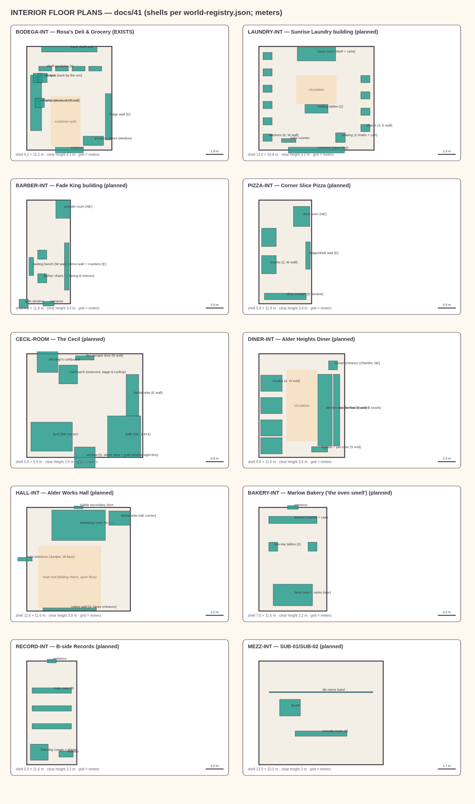

# Doc 41 — Interior Design Catalogue: floor plans before construction

> **Deliverable C.** Ten interiors, planned to fixture level. Shells, fixtures,
> circulation and interaction points all live in `world-registry.json`
> (`interiors[]`) and render from the same data — the sheet below is generated,
> not drawn by hand: `node scripts/design/render-world.mjs`.

---

## 1. The laws interiors obey

1. **The shell matches the exterior.** Every shell is inside its building's
   registered footprint (validator-checked) — the bodega is 9.2 × 11.2 m inside
   because the building says so, not because the room wanted to be bigger.
2. **The door matches the shipped entrance.** ROS-01's door gap (x −17.5..−14.5),
   the laundry bay (x −5), the Cecil's fire-escape door (x 13 at the y 8.35
   landing) are shipped facts; interiors arrange themselves around them.
3. **Circulation is explicit.** Every plan marks a clear zone the camera and a
   0.7 m capsule can actually use — the E2E lesson (a 27 cm pocket is not a lane).
4. **One interaction anchor minimum per room**, positioned where the chase cam
   can still see the street (the postcard law: interiors are not dead space).
5. **Palette and furniture reuse the shipped builders** — bank materials, the
   sign factory for any text, Doc 04 object canon for hero props.

## 2. The ten rooms

### 2.1 BODEGA-INT — Rosa's Deli & Grocery *(EXISTS — formalized here)*
Shell 9.2 × 11.2 m, clear 4.1 m. Entrance S (the shipped gap). Counter L on the
west wall (shipped at −19.6, 13.5) with Rosa's mark and the griddle/urn; back
shelf wall N (shipped −16, 19.3); four gondola shelves mid-floor; fridge wall E;
produce crates in the window; the customer aisle is a protected 3.2 × 5.4 m clear
zone. **Interaction anchors:** the shelf shop (shipped, −18.5, 13.5), the counter,
the cat spot by the urn. This room is the game's heart — the registry freezes it
so no future agent refits it by accident.

### 2.2 LAUNDRY-INT — Sunrise Laundry *(bay exists → full interior W5)*
Shell 12 × 10.8 m behind the shipped bay. Six washers down the west wall, four
dryers east, two folding tables centre, Sal's counter at the bay's mouth (shipped
position honoured), two chairs + a cart NW, back room with shelving and linen
carts N. The shipped spinning drum (washerLoad) keeps its role — the near washer
is the one that spins. **Loop:** the wash ($3, shipped) gains dry-and-fold as a
second beat; Sal's counter stays the story anchor.

### 2.3 BARBER-INT — Fade King *(W5)*
Shell 4.8 × 11.4 m (a narrow real barbershop). Two chairs on the west wall facing
the mirror wall E, waiting bench W, powder room NE, the striped pole window at
the door (shipped pole at 33.85 stays). **Loop:** the trim ($12, shipped) moves
from a facade prompt to a chair you sit in; the mirror talks like the clippers do.

### 2.4 PIZZA-INT — Corner Slice *(W5)*
Shell 5.8 × 11.4 m. Slice counter at the S window, deck oven NE, two booths W,
drink fridge E. **Loop:** the dollar slice (GDD §4.5 starter trinity) as a
standing order; the rat postcard (§5.1) is a subway problem, not a pizza problem.

### 2.5 CECIL-ROOM — the player's room *(W5, the new home)*
Shell 5.6 × 5.0 m at **y 8.35 — the top fire-escape landing level** (the shipped
trigger volumes already climb there). Bed SW, kitchenette E, 1.6 × 2 m bath NE,
street window S with the **gold-window sight-line** (the game's oldest promise,
now visible from the player's own bed), the Map's corkboard by the door, and the
**roof hatch reserved at (12.2, −15.2)** — the stage-5 Rooftop's future stair.
The room ships furnished sparse: the stool pattern (bought things appear).
Reserved beat (from the external review pass, deferred to the lead's Days-5+
writing): a **window-gaze interaction** — one quiet look out the S window that
lets the skyline moment land before the postcard composes. NOT adopted from the
same source: a sleep-to-advance-day mechanic — day transitions belong to the
step machine and the postcard ritual, and a second day-end point would split
the E2E's ending contract.

### 2.6 DINER-INT — Alder Heights Diner *(W5)*
Shell 9.6 × 11.6 m, corner chamfer entrance NE. Counter bar with eight stools
down the east wall, kitchen line behind it, four booths west, register + pie case
south end. **Anchors:** counter seat (regulars' dialogue), a booth (group beats),
the pie case (the "order like a local" teach). Big Mike's future home.

### 2.7 HALL-INT — Alder Works Hall *(W5)*
Shell 11.6 × 11.6 m. Main hall (open floor, folding chairs) S+centre, workshop
room N, kitchenette NE corner, notice wall by the entrance (the bulletin board's
big sibling), Gable secondary door N. **Anchors:** the notice wall (day-keyed
dressing like the shipped board), the workshop table (craft beats), the hall
itself (the block party's rain plan).

### 2.8 BAKERY-INT — Marlow Bakery *(W5)*
Shell 7.6 × 11.6 m. Service counter + case just inside, deck oven + racks rear,
two two-top tables. The morning anchor: the smell is audio's job (Doc 32 ledger),
the bagel silhouette is the window's.

### 2.9 RECORD-INT — B-side Records *(W5)*
Shell 5.6 × 11.6 m. Three crate rows, listening corner with the player, counter.
**The Happy-Accident shop** from GDD §4.3: the game's lore plants it one street
from the subway; first visit is a designed "getting lost is finding somewhere"
beat.

### 2.10 MEZZ-INT — the K mezzanine slice *(W5, optional)*
Below-grade room 12 × 10 m under the plaza (y −3.2), reached by the shipped stair
footprint: four turnstiles, the booth, and the tile name band — **ALDER HEIGHTS**
in mosaic (the GDD's subway-tile canon). Optional: the plaza and control house
already carry the station's identity; this slice exists only if the Subway
University beats need an interior.

## 3. What is deliberately NOT designed here

- **Interior wall materials beyond palette** — Doc 04's art pass owns surfaces.
- **Lighting rigs** — interiors inherit the shipped emissive-window + warm-slab
  technique (laundry back wall pattern); no new light types.
- **NPC pathing inside rooms** — the interaction registry's proximity system
  carries interiors today; steering inside rooms is a W5 engineering call, not a
  design promise.
- **The café's final fit-out** — KTN-06's shell is designed; its activation
  (Doc 33 weeks 4–8) is a story milestone, and its interior flexes with it.
